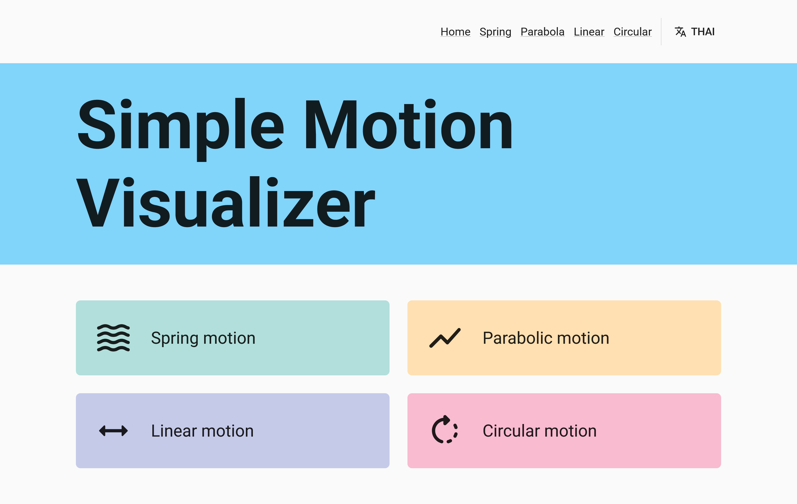
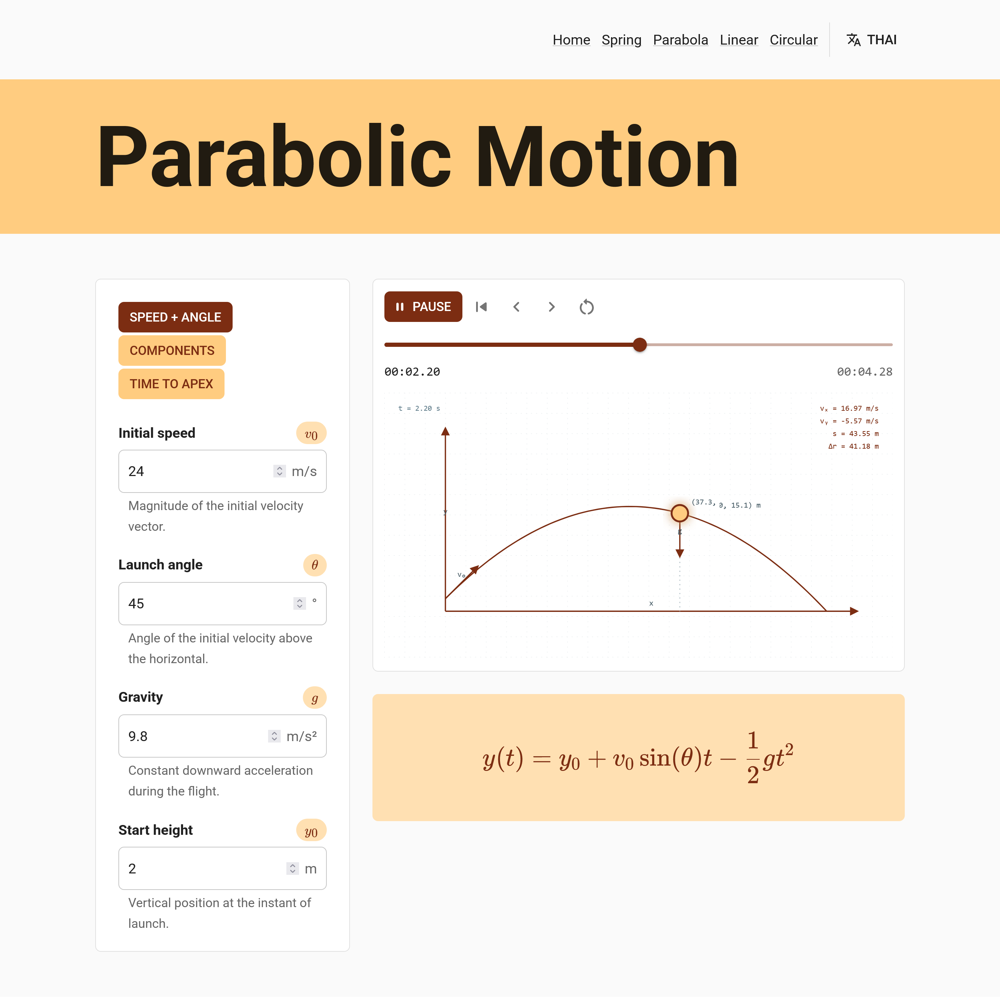
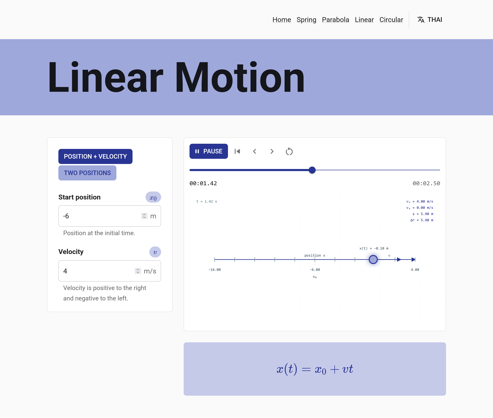
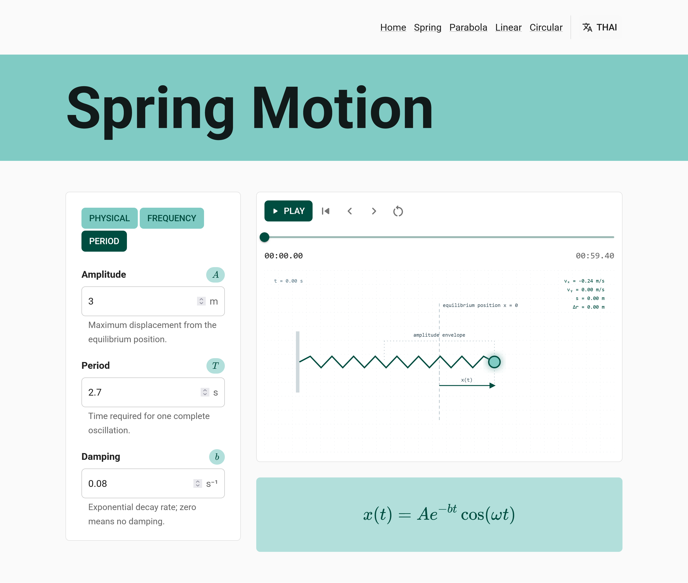
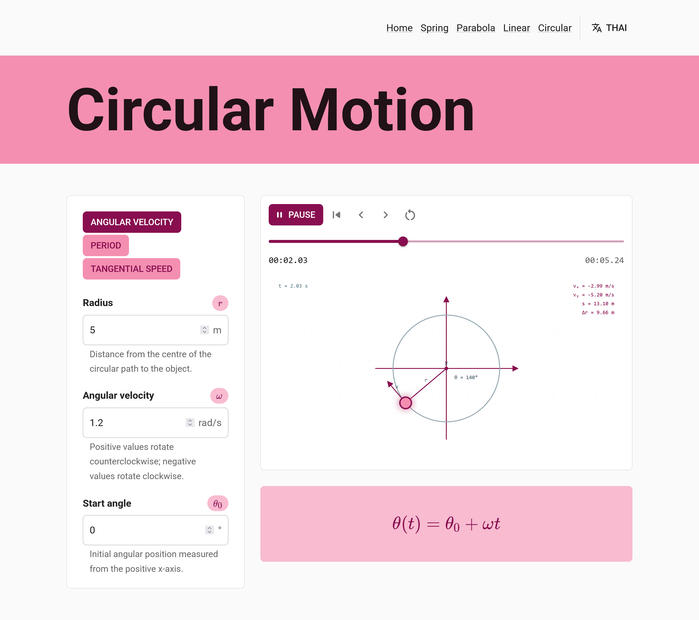

> Powered by [React Spring](https://www.react-spring.dev/), [Tanstack Router](https://tanstack.com/router/latest), [KaTeX](https://katex.org/) and a couple more lovely libraries!

# ~Simple Motion Visualizer

A set of visualizers for simple motion; linear motion, projectile motion, simple harmonic motion, and circular motion with parametric adjustments.

## ~Projectile Motion

## ~Linear Motion

## ~Simple Harmonic Motion

## ~Ciruclar Motion

